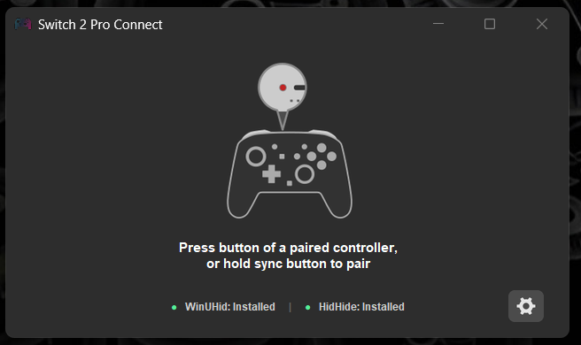
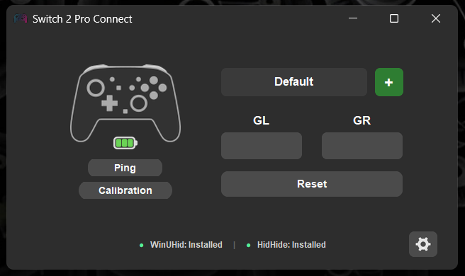

<div align="center">
  
  <h1>Switch 2 Pro Connect</h1>
  <p>A dedicated Switch 2 Pro Controller companion utility for Windows and Linux with back-paddle remapping, automatic per-game profiles, and a streamlined UI.</p>
  <p>Vibe coded by <a href="https://github.com/sheeshfr"><b>SheeshFr</b></a></p>
</div>

---

## Features

- **Switch 2 Pro Controller Exclusively:** Strips out Joy-Con and secondary controller complexity to deliver a dedicated, reliable setup for the Switch 2 Pro Controller over Bluetooth or USB-C.
- **Convenient Back-Button Assignment:** Quickly remap the GL and GR back paddles by tapping the paddle and pressing the desired target button on the controller. Pressing the **C** button mid-game instantly brings the interface into focus for on-the-fly tweaks.
- **Automatic Per-Game Profiles:** Assign distinct back-button layouts per game. The app detects active foreground processes (including Wine/Proton games) and switches profiles automatically as you launch or switch between games.
- **Native Cross-Platform (Windows & Linux):** Built-in support for Linux via `/dev/uinput` with force-feedback rumble, gyro mouse, exclusive device grab (`EVIOCGRAB` to prevent double inputs without needing HidHide), and X11/Wayland window tracking.

<div align="center">
  
  &nbsp;
  
</div>

---

## Setup

### Windows

1. Download the release archive: [Switch2ProConnect_v1.0_Release.zip](https://github.com/sheeshfr/Switch2ProConnect/releases/download/v1.0/Switch2ProConnect_v1.0_Release.zip).
2. Extract the archive and launch `Switch2ProConnect_v1.0_(ShFr_UI_Mod).exe`.
3. In **Settings**, install the required drivers:
   - **Wireless Driver (WinUHid)** for Bluetooth emulation.
   - **Wired Driver (HidHide)** for USB-C cable play.
4. Connect the controller:
   - **Bluetooth**: Hold the **SYNC** button on the controller until the LEDs cycle; pairing is automatic.
   - **Wired**: Connect via USB-C cable.
5. Map back buttons as desired and configure per-game profiles.

### Linux

1. Clone or extract the repository onto your Linux system.
2. Ensure the launcher files are executable (only needed once):
   ```bash
   chmod +x Switch2ProConnect.sh Switch2ProConnect.desktop
   ```
3. Simply **double-click** the **`Switch 2 Pro Connect.desktop`** entry (it displays the Switch 2 controller logo!) or run:
   ```bash
   ./Switch2ProConnect.sh
   ```
   * **First Launch**: The launcher automatically detects that it is the initial run, creates the Python virtual environment (`.venv`), installs all required packages, prompts to install controller udev rules to `/etc/udev/rules.d/`, and adds a shortcut to your desktop application launcher with the logo icon.
   * **Subsequent Launches**: The launcher verifies the prerequisites and immediately launches the app in the background—no terminals, prompts, or delays!
4. Connect the controller:
   - **Bluetooth**: Hold the **SYNC** button on the controller until the LEDs cycle; pairing is automatic.
   - **Wired**: Connect via USB-C cable.
5. On Linux, virtual Xbox 360 controller emulation and force-feedback rumble work natively through `/dev/uinput`—no proprietary drivers (ViGEmBus or WinUHid) needed! Exclusive device grabbing (`EVIOCGRAB`) automatically prevents duplicate inputs in Steam, Wine/Proton, and native games without needing HidHide.

---

## Credits

This mod is based on open-source reverse-engineering and driver development from the community:

- **[TommyWabg/Switch2Connect](https://github.com/TommyWabg/Switch2Connect)**: Base application and architecture.
- **[Nadeflore/switch2-controllers](https://github.com/Nadeflore/switch2-controllers)**: Switch 2 BLE protocol reverse engineering.
- **[lurebat/WinUHid](https://github.com/lurebat/WinUHid)**: Virtual HID driver for controller emulation.
- **[nefarius/ViGEmBus](https://github.com/nefarius/ViGEmBus) & [HidHide](https://github.com/nefarius/HidHide)**: Virtual gamepad emulation framework and device hiding filter driver.
- **[vadimgrn/usbip-win2](https://github.com/vadimgrn/usbip-win2)**: USBIP driver backend.
- **[TheFrano/joycon2py](https://github.com/TheFrano/joycon2py)** & **[german77/JoyconDriver](https://github.com/german77/JoyconDriver)**: Controller protocol references.
- **[LeonChrome/XinHeLianSheng-Pro2-Bridge](https://github.com/LeonChrome/XinHeLianSheng-Pro2-Bridge)** & **[RyanCopley/NSO-GameCube-Controller-Pairing-App](https://github.com/RyanCopley/NSO-GameCube-Controller-Pairing-App)**: Communication and firmware references.

---

## License

Licensed under the [GNU General Public License v3.0 (GPL-3.0)](LICENSE.md). All source code, driver scripts, and build tools are included in this repository.
